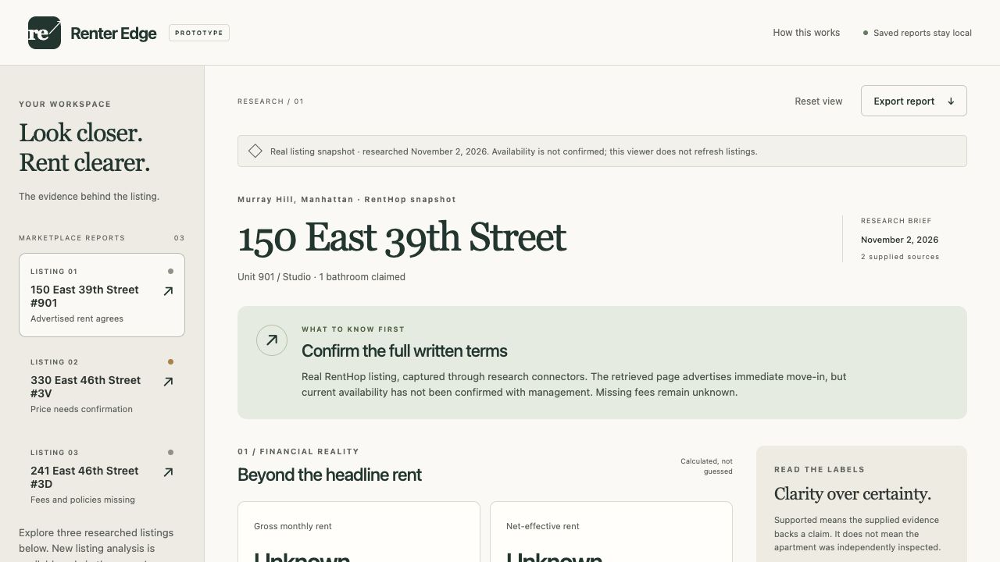

# Renter Edge

I built Renter Edge out of curiosity: could AI help me look past rental marketing and understand what I would actually need to confirm before renting? It turns listing text into a report of advertised costs, supporting evidence, missing information, and questions for the broker. Built by Cody Nguyen with Codex.




## Why a dedicated tool?

A general chat can summarize a listing. Renter Edge adds a consistent report format, source-linked findings, explicit unknowns, deterministic arithmetic, and an exportable broker checklist. For example, a $3,430 advertised price with an unknown gross/net basis stays in the evidence but does not become a verified gross-rent input.

## My decisions

I chose the renter problem and constrained the prototype to one marketplace. I used Codex to implement and debug it, separated private paid analysis from public saved reports, and chose to show missing information rather than manufacture complete answers. During live testing, I resolved a JSON-mode request error and surfaced provider billing failures. These demonstrate implementation decisions; usefulness to other renters has not yet been validated.

## Architecture

The static viewer validates and renders JSON reports. The optional local Node server retrieves listing text through Parallel, asks OpenAI for a report, validates the structure, and assigns source provenance. Cost calculations run in ordinary JavaScript. Source content and model text are untrusted. The public static deployment has no analysis backend or provider secrets.

## Try the demo

Run the app locally using the steps below. No API keys are needed to explore the three saved reports. Choose a listing, enter a monthly budget, inspect the evidence and unknowns, and review questions to ask the broker. Use **Import report** to open any JSON report in `reports/`.

The interview backup is [150 East 39th Street #901](reports/150-east-39th-901-snapshot-2026-11-02.report.json), a dated research snapshot exported November 2, 2026. It is the built-in researched example, not the subsequent live AI output. [Original RentHop listing](https://www.renthop.com/listings/150-e-39th-st/901/77243945/show). Availability and prices may change.

## Run locally

Requires Node.js 20 or later. No packages need to be installed.

```sh
npm start
```

Open http://127.0.0.1:4173. The preview server serves only `dist/`, not the private configuration or research folder. Set `PORT` if 4173 is already in use.

```sh
npm test
```

## What works

- Three real RentHop listing snapshots: 150 East 39th Street #901, 330 East 46th Street #3V, and 241 East 46th Street #3D. Research retrieved November 2, 2026; current availability is not independently confirmed.
- Supplied monthly rent versus calculated net-effective rent, known recurring and upfront subtotals, adjustable applicant/leaseholder count, and a budget comparison.
- Evidence filters, source disclosures, and a session-only broker-question checklist.
- Local JSON report import/export, with source-reference and input validation. Imported text is rendered as text, not executable markup.
- Responsive layouts and keyboard-accessible controls.

Use **How this works → Download sample report**, or **Export report**, for a valid import sample. Report version 1 is documented in `docs/REPORT_FORMAT.md`. Import `reports/180-water-312.report.json` to explore the historical research case. The original research evidence packet is a separate audit format, not an import file.

## Live versus recorded behavior

The app displays supplied reports and optionally analyzes RentHop URLs through server-side Parallel and OpenAI APIs. It does not inherit this chat’s connector authentication. Live research takes place in the accompanying Codex workflow using Parallel first, TinyFish second, and Exa third. The three built-in cases are real marketplace snapshots. Parallel returned older acquisitions, TinyFish refreshes were blocked, and Exa returned updated content without acquisition timestamps. See `research/MARKETPLACE_SOURCES.md`. Fictional edge cases are retained only as test fixtures. A separate historical research packet is stored in `research/`.

Imported report files are processed in browser memory. They are not uploaded or persisted across reloads. Export includes report content, not temporary budget inputs or checklist state. No external fonts, analytics, or runtime dependencies are used.

## Limits

Supported evidence is not independent verification. Unknown costs remain visible and are excluded from **known subtotals**, not asserted to be zero. The upfront subtotal counts a deposit as cash needed, not rent expense. The calculator assumes one applicant per leaseholder and keeps the unit deposit fixed. Its net-effective figure applies only to the supplied original lease term; takeover eligibility and payment timing must be confirmed separately.

No legal conclusions, safety guarantees, or automated housing decisions are made. A missing public record does not establish a clean history. This is a portfolio prototype, not a production apartment-search service.

## Validation

22 automated tests pass. They cover report validation, arithmetic, unsafe input, URL restrictions, private access controls, mocked provider responses and actionable billing errors. See `docs/QA.md` for the chronological verification log. The owner successfully exercised live analysis in Comet after API billing was enabled; this was a manual smoke test, not a broad model-quality evaluation.

## Optional private live analysis

Copy `.env.example` to `.env` locally and fill OPENAI_API_KEY, OPENAI_MODEL (a Responses-compatible model supporting JSON mode), and PARALLEL_API_KEY. Never commit credentials. Start with `node --env-file=.env server.mjs`. Live analysis requires the private-mode settings below; saved reports remain usable without keys. Pasted text requires OpenAI only and is labeled unverified; URL extraction requires Parallel. TinyFish/Exa fallback adapters are not implemented in this first version.

The form sends listing content to OpenAI and URLs to Parallel. Avoid personal information. OpenAI requests use store:false; this does not promise zero provider retention. The backend validates model JSON using the report validator and overwrites source URL/provenance. Model semantic accuracy still requires review.

Prototype controls: exact RentHop HTTPS host/path allowlist, 30 KB request limit, 20,000-character evidence limit, one in-flight request, 20 attempts per process lifetime, bounded output and provider timeouts. Restart resets the request counter. These are not a durable dollar spending cap or production abuse controls. Before public deployment, add durable quotas, provider budget controls and hosted-origin configuration. The server currently binds localhost only.

Documentation used: [OpenAI structured outputs](https://developers.openai.com/api/docs/guides/structured-outputs) and [Parallel Extract](https://docs.parallel.ai/extract). JSON mode plus validation is used; strict schema outputs and live-provider evaluation remain improvements.

## Public versus private demo

Default mode is the public saved-report viewer. Even with provider keys configured, POST /api/analyze is denied unless RENTER_EDGE_LIVE=true and a demo token of at least 32 characters is configured. The analysis form stays hidden in default mode and on static hosting.

For your local demonstration only: generate a random token (for example, `openssl rand -hex 32`), store it as RENTER_EDGE_DEMO_TOKEN in the ignored .env file, and set RENTER_EDGE_LIVE=true. Start with `node --env-file=.env server.mjs`, then enter that token in the private demo form. It is sent in an authorization header and is not saved by app code or returned by the server. Never commit/share the token. Turn the flag off and restart afterward. Keep public hosting in default mode with no provider secrets.

This adds server-side access control, not just a hidden form. Your private analyses use your provider credits. Public saved-report exploration makes no paid API calls. Keep live mode local for now; public live hosting still requires durable quotas, spending controls and HTTPS deployment configuration.

## Public deployment

Import this GitHub repository into Vercel using the Other framework preset. The committed vercel.json serves only dist/ with no build or install step. Do not add provider keys or enable live analysis in public hosting. The private Node server is not part of this static deployment. A deployment URL will be added only after public access has been verified.

## Demo and evaluation

See [the interview walkthrough](docs/DEMO.md), [AI evaluation](docs/EVALUATION.md), and [renter feedback protocol](docs/USER_FEEDBACK.md). Automated tests establish software behavior, not broad AI accuracy or customer demand.
